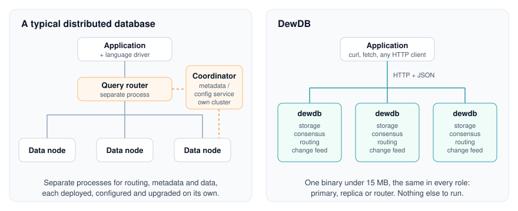

<p align="center">
  <picture>
    <source media="(prefers-color-scheme: dark)" srcset="docs/assets/logo-dark.svg">
    
  </picture>
</p>

<h3 align="center">The distributed document database in a single binary.</h3>

<p align="center">
  Replication, sharding, automatic failover and change streams, all in <b>one binary under 15 MB</b>.<br>
  No coordinator, no metadata service, no driver to install.
</p>

<div align="center">

| **< 15 MB** | **~100 ms** | **~10 MB** | **0** |
|:---:|:---:|:---:|:---:|
| one binary, every role | launch to serving requests | memory at idle | extra services to run |

</div>

<p align="center">
  <a href="https://github.com/dewdb/dewdb/releases/latest"></a>
  <a href="LICENSE"></a>
  <a href="Cargo.toml"></a>
  <a href="docs/documentation.md#16-rest-api-reference"></a>
</p>

<p align="center">
  <a href="https://dewdb.com"><b>Website</b></a> ·
  <a href="docs/getting_started.md"><b>Getting started</b></a> ·
  <a href="docs/features.md"><b>Features</b></a> ·
  <a href="docs/documentation.md"><b>Reference</b></a> ·
  <a href="https://github.com/dewdb/dewdb/releases/latest"><b>Download</b></a>
</p>

<br>

Running a distributed database usually means running a fleet: data nodes, query routers, and a
separate consensus or config cluster to keep them in agreement. **DewDB folds all of that into one
binary.** Download it, write a five-field config, and you have a node that serves requests in about a
tenth of a second. Add two more and you have a quorum-replicated cluster that fails over by itself.
Put a router in front of several groups and it shards. It's the same binary every time.

Written in Rust. It speaks plain HTTP and JSON, so `curl`, `fetch`, or any HTTP client is already a
driver. Apache 2.0.

<sub>Numbers measured on the v1.2.1+ Windows x86_64 release build. The static Linux build is
smaller. Startup and memory are for a fresh single node on a laptop.</sub>

## Quick look

Write a nested document. Collections are created on first use, with no schema and no create step.

```bash
curl -s -X PUT localhost:8081/collections/users/docs/u1 \
  -H 'content-type: application/json' \
  -d '{"value":{"name":"ada","age":36,"profile":{"city":"london"}}}'
```

Query it with a filter on a nested field, sorted and projected:

```bash
curl -s --get localhost:8081/collections/users/query \
  --data-urlencode 'filter={"age":{"$gte":30},"profile.city":"london"}' \
  --data-urlencode 'sort=age:desc' \
  --data-urlencode 'fields=name,profile.city'
```

```json
{"items":[{"name":"ada","profile":{"city":"london"}}],"next_cursor":null}
```

Watch the collection for changes that match a filter:

```bash
curl -N --get localhost:8081/collections/users/changes \
  --data-urlencode 'filter={"profile.city":"london"}'
```

These commands run against the single node from [Install](#install). The same API serves a
replicated, sharded cluster.

## Why DewDB

<p align="center">
  <picture>
    <source media="(prefers-color-scheme: dark)" srcset="docs/assets/architecture-dark.svg">
    
  </picture>
</p>

**Distribution lives in the database.** DewDB keeps replication, failover, sharding, routing and
change streams inside the database process. Consensus, ownership and routing run in the same
process that stores the documents, with no separate coordinator service.

**One process, one file, one protocol.** The whole database is one binary under 15 MB. A node
is `dewdb --config dew.json`, and storage is a directory. The wire format is HTTP and JSON, so there is nothing to install on the application side.

**Strong consistency.** Writes commit by quorum, and readers see committed state only. A
single-document write is atomic: it becomes durable as one frame or not at all. `read=quorum` is
linearizable from the point the page starts. It establishes that point through a read index
instead of assuming it from a lease.

**The API tells you what actually happened.** If a write is durable but did not meet its write
concern, the API answers `202` with `acks` and `required` in the body, not `200`. A shard that does
not own a key answers `409` and names the real owner. An unknown `?w=`, an unparseable sort, or a
cursor that does not belong to its query returns `400`. None of them fall back to a silent
default.

**Permissive licence.** Apache 2.0, including for redistribution inside software you ship to
someone else's infrastructure.

## Features

- [x] **Documents.** Schemaless JSON in auto-created collections, with CRUD, merge patch, bulk writes and `ETag` conditional writes ([docs](docs/features.md#1-documents-and-collections))
- [x] **Document expiry.** Per-document `expire_at` or a collection TTL, removed by replicated deletes ([docs](docs/features.md#1-documents-and-collections))
- [x] **Queries.** 17 field operators over dotted paths, `$and`/`$or`/`$nor`, multi-key sort, projection and cursor paging ([docs](docs/features.md#3-query-engine))
- [x] **Secondary indexes.** Indexes on dotted fields, replicated and carried across shard groups ([docs](docs/features.md#3a-secondary-indexes))
- [x] **Aggregation.** `count`, `sum`, `avg`, `min`, `max`, grouped and merged correctly across shards ([docs](docs/features.md#3b-aggregation))
- [x] **Change streams and CDC.** A resumable feed over SSE, WebSocket, or signed webhooks ([docs](docs/features.md#3c-change-streams-and-cdc-delivery))
- [x] **Replication and failover.** Quorum commit, pre-vote elections and automatic failover with no operator step ([docs](docs/features.md#5-consensus-and-failover))
- [x] **Sharding.** Hash ring or explicit ranges, online migration and optional auto-rebalancing ([docs](docs/features.md#8-sharding-and-topology))
- [x] **Security.** API keys or bearer tokens, an admin tier, in-process TLS and hot credential reload ([docs](docs/features.md#12-security))
- [x] **Operations.** Structured logs, JSON and Prometheus metrics, health checks and background compaction ([docs](docs/features.md#13-observability-and-operations))

---

## Install

### Linux

Each release includes a statically linked x86_64 build (musl), so it runs on any x86_64 Linux
distribution:

```bash
curl -LO https://github.com/dewdb/dewdb/releases/download/v1.2.1/dewdb-v1.2.1-linux-x86_64-musl.tar.gz
```

```bash
tar xzf dewdb-v1.2.1-linux-x86_64-musl.tar.gz
```

```bash
./dewdb --version
./dewdb init
./dewdb
```

### Windows, PowerShell

```powershell
iwr https://windows.dewdb.com -useb | iex
```

```powershell
dewdb --version
dewdb init
dewdb
```

This installs DewDB for the current user under `%LOCALAPPDATA%\DewDB` and adds it to your user
`PATH`. It does not need Administrator privileges. Open a new terminal after installing to pick up
the `PATH` change.

A Windows x86_64 ZIP is also on the
[latest release](https://github.com/dewdb/dewdb/releases/latest) if you would rather not pipe a
script. Each release page includes a `SHA256SUMS.txt` for checking the download.

### Build from source

```bash
cargo build --release
```

```bash
./target/release/dewdb init
./target/release/dewdb
```

### Your first node

`dewdb init` writes a starter `dew.json` in the working directory, and `dewdb` reads it from there:

```json
{
  "node_id": "n1",
  "role": "shard",
  "shard_role": "primary",
  "listen_addr": "127.0.0.1:8081",
  "data_dir": "./data"
}
```

That is all a single node needs. It leads itself, commits on its own fsync, and is ready to serve
the [Quick look](#quick-look) commands on port 8081 right away. To use a config file somewhere else,
pass `--config`. [`examples/dew.json`](examples/dew.json) is another single-node config, listening
on port **8090**.

The full walkthrough, from this node to a replicated, sharded, authenticated cluster, is in
[docs/getting_started.md](docs/getting_started.md). Every command in it runs as written.

---

## What you get

| Area | Capability |
|---|---|
| Data model | Schemaless JSON documents in auto-created collections, string keys |
| Expiry | Per-document `expire_at` or a collection TTL, removed by replicated deletes that reach the change feed |
| API | REST over HTTP: CRUD, merge patch, bulk writes, query, aggregation, collection and index admin, cluster control |
| Query | 17 field operators (equality, comparison, `$exists`, `$type`, `$prefix`/`$suffix`/`$contains`, `$all`/`$size`/`$elemMatch`, `$not`) composed with `$and`/`$or`/`$nor`, over dotted paths, with multi-key sort, projection and cursor paging |
| Indexes | Per-collection secondary indexes on dotted fields, replicated as log entries and carried across shard groups by a cluster-wide catalogue |
| Aggregation | `count`, `sum`, `avg`, `min`, `max`, grouped on dotted fields, merged across shards through the totals rather than the answers |
| Change streams | A resumable per-collection feed of committed inserts, updates, deletes and drops, filtered like a query, cluster-wide through a router |
| CDC delivery | The same feed over SSE, WebSocket, or webhooks that push signed batches with retries, capped backoff and a majority-committed delivery position |
| Durability | Append-only WAL, CRC per frame, group-commit fsync, torn-tail recovery |
| Consensus | Raft-shaped: monotonic terms, pre-vote elections, log-freshness checks, leader leases, joint-consensus membership changes |
| Replication | Leader-driven and pipelined, with tail truncation, gap repair and snapshot fallback |
| Write safety | `w=1`, `majority`, `all` or `N`, with `wtimeout`, and an explicit `202` when the concern is unmet |
| Scale-out | Consistent-hash ring or explicit ranges, online migration, optional auto-rebalancing |
| Operations | Structured logs, JSON and Prometheus metrics, health checks, background compaction |
| Security | API keys or bearer tokens, an admin tier over topology, drops, index definitions and collection TTLs, shared secret on internal routes, hot credential reload |

---

## Replication and failover

Three nodes, each with its own port and data directory. The primary:

```json
{
  "node_id": "n1",
  "role": "shard",
  "shard_role": "primary",
  "listen_addr": "127.0.0.1:9501",
  "data_dir": "./n1",
  "replicas": ["http://127.0.0.1:9502", "http://127.0.0.1:9503"],
  "peers":    ["http://127.0.0.1:9502", "http://127.0.0.1:9503"]
}
```

A replica is the same file with `shard_role: "replica"` and `primary_addr` pointing at the leader.
Write with a quorum requirement:

```bash
curl -s -X PUT 'localhost:9501/collections/users/docs/u1?w=majority' \
  -H 'content-type: application/json' -d '{"value":{"name":"ada"}}'
```

Stop the leader. A survivor takes over the term and accepts writes within the heartbeat timeout
plus election jitter, with no operator step and no external arbiter. A replica that fell behind
repairs itself from WAL frames. If it fell behind further than retention, it takes a full
collection snapshot instead.

## Sharding

A router is a node with `role: "router"`. It holds no data: it hashes `collection:key`, finds the
owning group in its cluster view, and forwards. Each group replicates and fails over independently.

```
                    ┌─► group A (leader + replicas)
client ──► router ──┤
                    └─► group B (leader + replicas)
```

Queries and aggregations fan out and merge. Sorted pages are merged in order, and aggregate totals
are combined through their counts rather than by averaging averages. To add a shard, call
`POST /cluster/migrate`: keys move in paced batches while both sides keep serving.

## Change streams and CDC

Events are published from the commit path and nowhere else, so a subscriber never sees a write that
a leader change could take back. Each event carries its own position, and `?after=` resumes from
it. If a position is older than the buffer, the request is refused with `410` and the oldest
position that still works. Positions are never skipped silently. The same feed is available as a
WebSocket, or pushed to your endpoint as signed, batched webhook deliveries. The acknowledged
webhook position is majority-committed, so delivery survives a failover.

---

## Consistency and durability

- Every mutation is a CRC-checked frame appended to a write-ahead log; the in-memory index maps a
  key to a frame location.
- A frame that is durable but not yet committed by a quorum is staged, not published. Readers and
  change streams see committed state only.
- Commit counts only entries from the current term. Membership changes move through a joint
  configuration, so the two halves of a change can never each reach a separate majority.
- Recovery truncates a torn tail rather than trusting it. A restart replays what was committed.
- Read preferences: default, `primary`, `quorum` (linearizable), `replica`.

## Scope

Current limitations:

| | |
|---|---|
| Transactions | Per document. Bulk writes are one group commit, accepted or refused whole; there are no multi-document transactions. |
| Conditional writes | Per document, with `ETag` and `If-Match`/`If-None-Match`; a bulk write cannot be conditional. |
| Indexes | Single-field, by value, non-unique, up to eight per collection. A filter with no eligible index scans a key range. |
| Aggregation | `count`, `sum`, `avg`, `min`, `max` over up to four grouping fields, bounded at 10 000 groups, computed per request. |
| Joins | Done in the client. Cross-shard work is per-key or fan-out. |
| Sizes | 10 MiB per stored record, 2 MiB per request body, 10 000 documents per query page. |
| TLS | In the process. Moving an existing plaintext cluster to TLS needs every node stopped at once, not a rolling restart. The cluster keeps its cluster view. The CA file reloads without a restart. |
| Audit | Collected in front of the node. |
| Change history | As far back as the per-collection change buffer holds. |

---

## Documentation

| | |
|---|---|
| [Getting started](docs/getting_started.md) | A walkthrough from one node to a sharded, authenticated cluster, with client snippets and troubleshooting. |
| [Your first application](docs/getting_started.md#10-your-first-application) | How a web application connects to DewDB: backend CRUD over `fetch`, queries that return their ids, and browser realtime proxied through your own backend. |
| [Features](docs/features.md) | Each capability, with the guarantee it gives and the limit that applies to it. |
| [Documentation](docs/documentation.md) | The reference manual: every config field, endpoint, status code, on-disk format and internal protocol. |

## Testing

```bash
cargo test
```

The suite is in-crate and runs against real nodes over real sockets. It covers consensus and
failover, ownership handover, query and aggregation correctness against unindexed twins,
change-stream resume, and webhook delivery. Benchmarks and long-running durability scenarios are
held back from the default run. Those scenarios include repeated crashes, cluster churn under load,
compaction interleaved with crashes, and a WAL cut off mid-record:

```bash
cargo test --release -- --ignored --nocapture bench
```

```bash
cargo test --release -- --ignored --nocapture soak
```

Set `DEWDB_SOAK_SEED=0x…` to run a different schedule than the fixed seed each scenario ships with.

## Community

- Found a bug or a claim in these docs that doesn't hold? [Open an issue](https://github.com/dewdb/dewdb/issues).
- Want to know when a release ships? Watch the repo and choose **Custom → Releases**.
- If DewDB is useful to you, a ⭐ helps other people find it.

## License

Apache License 2.0. See [LICENSE](LICENSE).
